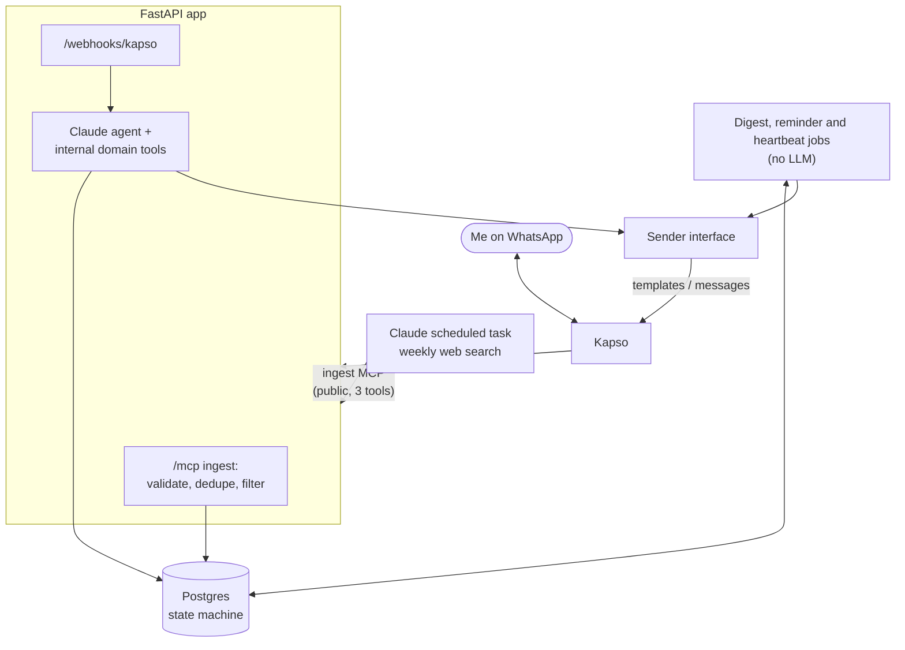

# events-assistant

[](https://github.com/guilhermedecastrogt/events-assistant/actions/workflows/ci.yml)

A personal WhatsApp assistant that finds tech events in Dublin, sends them to me one by one,
understands replies like "going, ticket later" or "not for me", and reminds me at the right time:
three days before events I'm attending, and every few days about tickets I still haven't bought.
It is a single-user project built to professional standards: tested state machine, plain SQL,
CI, ADRs.

## Core principle

**The LLM is the interface. The database is the state machine.**

Claude turns messy language into a tool call. Postgres and plain Python own every fact: event
status, dates and reminders. Reminders fire from deterministic code and never touch the LLM.
Quick-reply buttons are preferred over free text, and the agent can only act through domain
tools, never raw SQL.

## Architecture



Full detail: [docs/ARCHITECTURE.md](docs/ARCHITECTURE.md).

## Tech stack

- Python 3.12, [uv](https://docs.astral.sh/uv/)
- Postgres 16, plain SQL migrations, psycopg 3 (no ORM)
- Pydantic for schemas
- FastAPI (webhook + ingest MCP in one app), MCP Python SDK, Anthropic SDK (later milestones)
- Claude scheduled task for weekly discovery ([prompt](prompts/discovery.md))
- Kapso for WhatsApp (later milestones)
- pytest, pytest-cov, ruff, pre-commit, GitHub Actions

## Run locally

Requirements: Docker and [uv](https://docs.astral.sh/uv/getting-started/installation/)
(`brew install uv` on macOS). uv installs Python 3.12 for you.

```bash
cp .env.example .env              # local defaults match docker-compose.yml
docker compose up -d db           # Postgres 16 on localhost:5432
uv sync                           # install dependencies into .venv
uv run python -m events_assistant.db.migrate   # apply SQL migrations
uv run pre-commit install         # ruff lint + format on every commit
uv run pytest --cov               # run the test suite with coverage
uv run ruff check . && uv run ruff format --check .
```

## Roadmap

- [ ] **M0 Foundations**: repo, docs, CI, Docker Postgres
- [ ] **M1 Schema + state machine**: tested transitions and reminder rules
- [ ] **M2 Reminder job**: due reminders sent via a fake console sender
- [ ] **M3 Ingest MCP + public deployment**: authenticated public `/mcp`, scheduled task submits events
- [ ] **M4 Agent + evals**: terminal chat works; 30+ eval cases pass in CI
- [ ] **M5 Webhook + Kapso**: real WhatsApp two-way, templates, buttons
- [ ] **M6 Digest job + heartbeat**: weekly capped digest, "show more", Monday no-ingest alert
- [ ] **M7 Hardening**: observability, retries, README polish

## Docs

- [Product requirements](docs/PRD.md)
- [Architecture](docs/ARCHITECTURE.md)
- [Architecture decision records](docs/adr/README.md)
- [Project conventions and working rules](CLAUDE.md)
